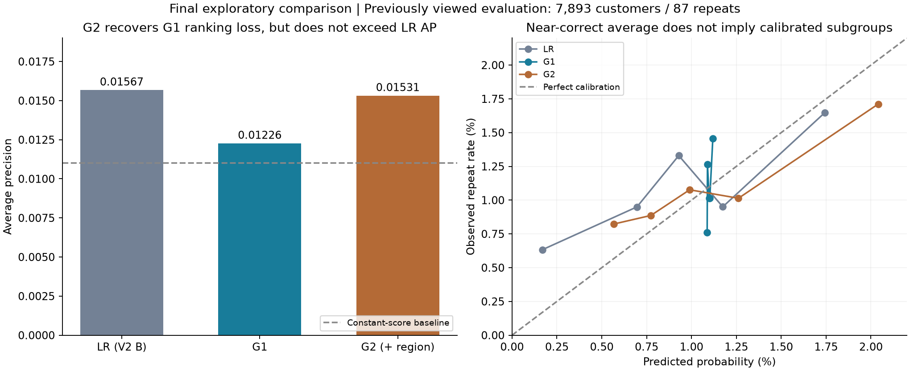

# Olist 客户复购：履约体验与地区消费结构

[English](README.md) · [研究方法](docs/methodology.md) · [实验记录](docs/experiment_history.md) · [复现说明](docs/reproduction.md)

基于 Olist 公开订单数据，研究履约体验和地区历史消费结构能否帮助预测客户复购。

**主要结论：** 去掉缺少全年数据支持的月份周期项后，概率低估明显缓解，但排序没有提高。截距校准没有改善后续时期的概率表现。地区消费结构未显示稳定的额外预测价值，最后一次 LightGBM 对照也未证明增加复杂度有明确优势。

分析已结束。本仓库保留全部历史阶段，以及所有没有改善和变差的结果。

## 研究问题

在首个观察订单已经送达、且送达前没有再次下单的客户中：

> 配送体验，以及首购品类与所在州历史消费结构的关系，能否改善未来90天内再次下单并获审批的预测？

业务动机是理解平台能否满足不同地区的客户，但能测量的只是配送、延误、运费和已成交结构。不能把品类占比直接当作地方文化，也不能用成交订单拆开真实偏好与供给限制。

## 数据与样本

[Olist 原始数据](https://www.kaggle.com/datasets/olistbr/brazilian-ecommerce)包含99,441笔订单、96,096位唯一客户。使用 `customer_unique_id` 识别客户。

- 首单送达、时间有效且送达前无其他下单：92,081人。
- 具备完整90天随访：65,493人。
- 再满足保守180天历史条件：**51,981人、567次复购，复购率1.091%**。
- 修订评估样本固定为 **7,893人、87次复购，实际复购率1.102%**。

观察截止取2018-08-01之前，避免将数据尾部的零星订单误当成完整随访。地区历史窗口全部位于2017年起连续有订单的月份。这是保守分析条件，并非官方确认的数据覆盖保证。

首单送达时开始预测；新订单必须在之后下单并在90天内获审批。后续取消不抹去已经观察到的审批事件。“首购”和“复购”仅指数据中观察到的行为。

## 分析过程与保留结果

**V1：逐层加入履约与地区信息。** 最终训练池为25,780人、303次复购。M1、M2、M3的AP分别为0.018493、0.019266、0.019296；前790人命中17、19、19位复购客户。履约增量较小，地区增量接近零；模型平均概率约0.54%，明显低于实际1.102%。

**V2：固定A/B/C诊断。** 使用6,459人、71次复购训练，12月60次复购做校准，之后不重训。

| 版本 | 平均预测概率 | Log loss ↓ | AP ↑ | 前790人命中 |
|---|---:|---:|---:|---:|
| A：保留月份 | 0.139% | 0.074706 | 0.015916 | 12 |
| B：去掉月份 | 0.942% | 0.061213 | 0.015668 | 11 |
| C：B＋截距校准 | 0.819% | 0.061531 | 0.015668 | 11 |

去月份改善了概率损失，没有提高排序。12月校准器因当月B高估而下调概率，在后续时期反而扩大低估。B/C全部排序与前790人名单完全相同。校准期均值匹配是拟合性质，不是未来校准成功的证据。

**V3：最后一次固定LightGBM对照。** 训练样本与V2一致，12月只按log loss早停，不再校准或重训。

| 模型 | AP ↑ | Log loss ↓ | 平均预测概率 | 前790人命中 |
|---|---:|---:|---:|---:|
| LR：V2的B | **0.015668** | 0.061213 | 0.942% | 11 |
| G1：相同信息的树模型 | 0.012260 | 0.060634 | 1.099% | 13* |
| G2：增加地区结构 | 0.015311 | **0.060511** | 1.127% | **18** |

G1选中第1轮，G2选中第146轮。G2对G1的AP、概率损失点估计都改善，但客户级和州级重采样的增量区间包含零。G2前790人命中更多，整体AP却仍略低于LR，不能宣布全面胜出。

\* G1最高分有1,548人完全同分，按固定客户ID顺序选790人得到13次复购；组内均匀随机选择的期望约11.23次。模型不能区分同分组内部的客户。



**三轮不能混成一个最优模型榜。** V1最终训练池更大；V2/V3是看过原评估结果后的探索修订，不是新的独立验证。方案只是在各轮运行前冻结，没有在最初查看评估结果前预注册。

## 两个品类只做描述案例

床浴桌用品、运动休闲在测试前训练池中客户量最多，但均未达到原定训练期复购事件门槛，因此没有独立建模。

| 品类 | 准时送达复购 | 延误复购 |
|---|---:|---:|
| 床浴桌用品 | 74/4,480（1.65%） | 5/478（1.05%） |
| 运动休闲 | 52/4,002（1.30%） | 3/341（0.88%） |

这些是全队列未调整比较，延误组事件仅5个、3个，区间很宽，不能证明改善配送会提高复购。按地区匹配程度分组也没有一致的单调趋势。

## 局限与结论

- 复购事件稀少，不足以支持大量城市、品类和交互分析。
- 只研究符合条件的已送达客户，不能代表取消或未送达客户。
- 没有平台外购买、搜索曝光、缺货或完整供给数据。
- 后续反复使用同一评估集；重采样区间无法消除适应性分析偏差，也未覆盖模型训练和早停选择不稳定性。
- 平均概率接近、AP提高或某个筛选规模命中更多，均不足以独立证明业务价值。
- 没有营销随机实验、真实利润验证、因果增量或生产部署。

项目结论是：**没有稳定验证地区指标的额外价值，也没有证明替换简单模型的必要性；这不等于证明地区或非线性永远无效。** 到此停止在本评估集上追加实验。

## 查看与复现

```text
README.md / README.zh-CN.md   英文主说明与中文说明
analysis/                    按阶段保留的原始分析脚本
configs/                     V1、V2、V3冻结方案
reports/audit/               样本审计与敏感性分析
reports/v1/                  逐层逻辑回归与品类描述
reports/v2/                  月份与概率校准固定对照
reports/v3/                  最后一次LightGBM固定对照
docs/                        方法、实验历史、来源、复现与许可
scripts/                     整理核验与隔离复现入口
data/raw/                    自行下载的数据，不进入Git
runs/                        显式复现生成的本地文件，不进入Git
```

`reports/audit/`、`reports/v1/`、`reports/v2/`、`reports/v3/`保留各阶段数字、图表及HTML报告。HTML需下载后在浏览器查看；GitHub不会把仓库内HTML直接当作网页运行。

```bash
python scripts/verify_package.py
```

上述命令仅检查证据、哈希、链接及源码语法，不训练。历史实验已执行；新整理的隔离复现入口仅完成静态检查，**未重新全流程运行**。见[复现说明](docs/reproduction.md)。本次打包没有追加实验。

研究使用公开数据，设计、实现、核验和文档整理有Codex辅助；不包装为真实企业项目、独立手写全部代码或生产经验。原始数据及客户级预测不入库，见[数据来源与许可](docs/data_and_license.md)。
